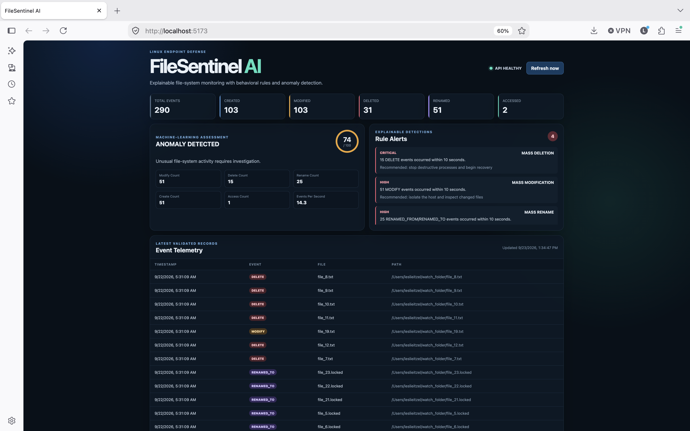
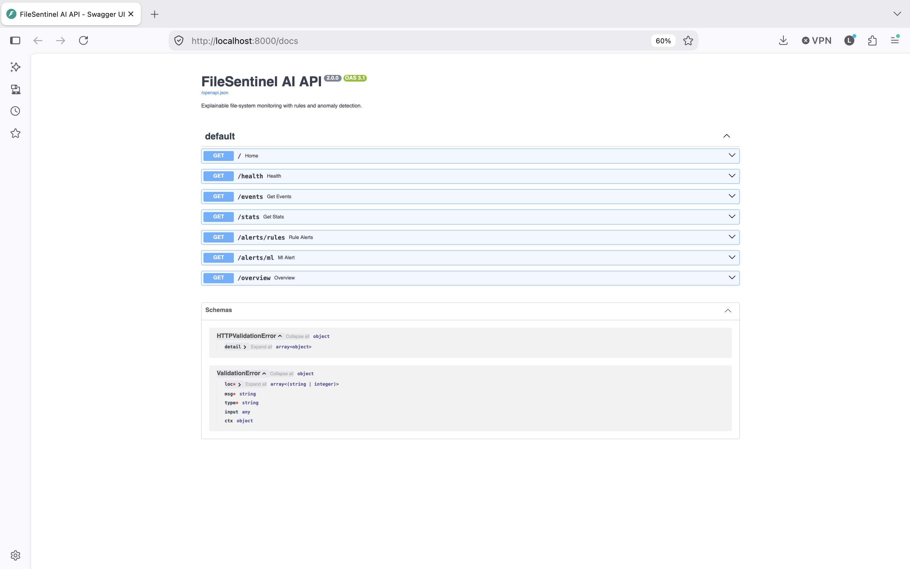
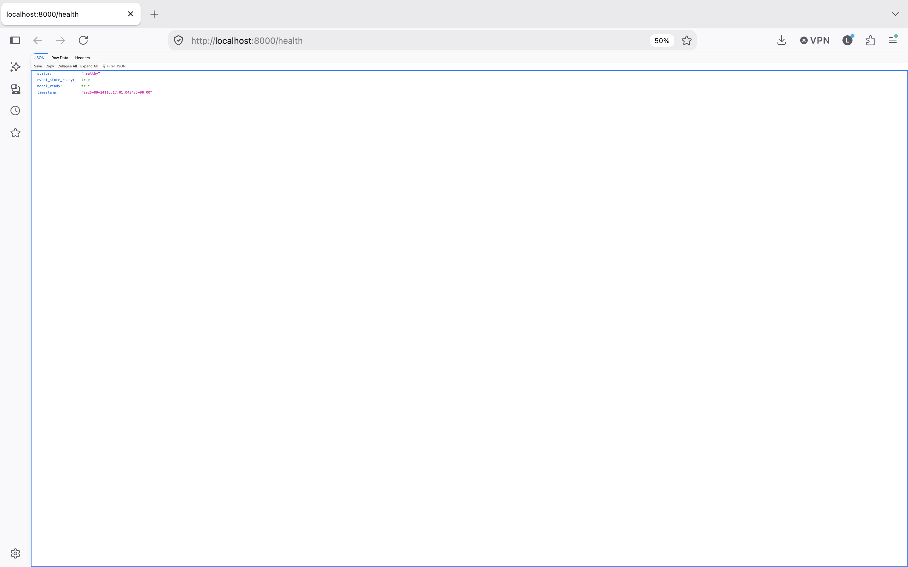
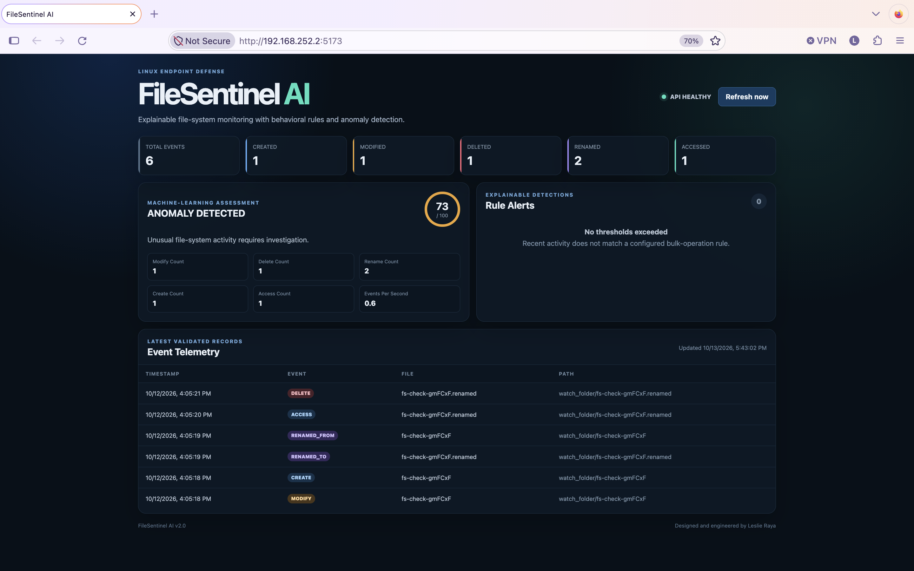

# FileSentinel AI

FileSentinel AI is a file-system monitoring and anomaly-detection project. It combines a Linux monitoring agent, a FastAPI backend, and a React dashboard to display file events and flag suspicious patterns.

The project uses behavioral rules to detect bulk file operations and an Isolation Forest model to assess unusual activity.

## Features

- Captures file creation, modification, deletion, rename, and access events on Linux.
- Records captured events in CSV format.
- Displays event counts and individual records in a React dashboard.
- Flags bursts of modifications, deletions, renames, and creations.
- Provides machine-learning anomaly assessments.
- Includes interactive API documentation and health checks.
- Provides a synthetic event simulation script and automated tests.

## Screenshots

### Dashboard

Displays file activity, anomaly assessments, and rule alerts.



### API Documentation

Interactive documentation for the backend endpoints.



### Health Check

Shows backend status and readiness of the event store and model.



### Linux Agent Verification

The Linux agent captured file activity on October 12, 2026. The dashboard was verified with the saved event log on October 13, 2026.

The verification covered all five supported activity types:

- CREATE
- MODIFY
- DELETE
- ACCESS
- RENAME

The log contains six records because one rename operation produces two records: `RENAMED_FROM` and `RENAMED_TO`.

The dashboard displayed:

- API HEALTHY status
- Six event records
- All five activity types
- Zero rule alerts
- An ML anomaly assessment with a displayed score of 73/100

The anomaly score describes the model's assessment of this test activity. It is not a measure of model accuracy or a validated probability of infection.

The dashboard read a saved verification CSV. This screenshot documents a completed test; continuous monitoring requires the backend to read the CSV being updated by the agent.



[Browse all screenshots](docs/images-filesentinel)

## Tech Stack

| Component | Technologies |
| --- | --- |
| Monitoring agent | C, Linux inotify |
| Backend | Python, FastAPI |
| Data processing | pandas, NumPy |
| Machine learning | scikit-learn, Isolation Forest, joblib |
| Frontend | React, JavaScript, Vite |
| Testing | pytest |
| Version control | Git, GitHub |

## Project Structure

| Location | Purpose |
| --- | --- |
| `agent/` | Linux monitoring agent, Makefile, and instructions |
| `backend/` | API, event processing, and detection logic |
| `data/` | Event CSV files |
| `frontend/` | React dashboard |
| `ml/` | Training code, model artifacts, and metadata |
| `scripts/` | Simulation and utility scripts |
| `Automated tests/` | Python test suite |
| `docs/images-filesentinel/` | Project screenshots |
| `docs/verification/` | Saved verification evidence |
| `README.md` | Main project documentation |

## How It Works

1. The Linux agent watches a selected directory for file activity.
2. Captured events are written to a CSV file.
3. The backend reads event data and calculates activity statistics.
4. Behavioral rules check for bulk-operation patterns.
5. The machine-learning model assesses activity features for anomalies.
6. The dashboard displays the backend results.

The agent and backend must have access to the same event data. When they run in separate environments, the CSV must be explicitly shared or transferred.

Behavioral rules and the machine-learning model assess activity separately. An ML anomaly assessment can appear even when no rule threshold is exceeded.

## Requirements

- Python 3 and pip
- Node.js and npm
- Git
- Linux, GCC, and Make for the monitoring agent

The C monitoring agent requires Linux because it uses inotify.

On macOS, run the agent inside a Linux virtual machine, such as a Multipass instance. The backend and frontend can run separately on the Mac.

The commands below use a macOS or Linux shell.

## Get Started

Clone the repository:

```bash
git clone https://github.com/leslieraya555/FileSentinel-AI.git
cd FileSentinel-AI
```

If you already have the project, open its existing main directory instead.

### 1. Set Up the Backend

From the main project directory:

```bash
python3 -m venv .venv
source .venv/bin/activate
python -m pip install -r backend/requirements.txt
```

### 2. Start the Backend

From the main project directory:

```bash
.venv/bin/python -m uvicorn backend.main:app --reload --port 8000
```

Leave this terminal running. This is the backend terminal.

Open the interactive API documentation:

[http://localhost:8000/docs](http://localhost:8000/docs)

### 3. Start the Frontend

Open another terminal in the main project directory:

```bash
cd frontend
npm install
npm run dev
```

Leave this terminal running. This is the frontend terminal.

Open the URL printed by Vite, normally:

[http://localhost:5173](http://localhost:5173)

If you use a different backend address or port, ensure that the frontend's API configuration points to that backend.

### 4. Generate Simulated Events

Open a third terminal in the main project directory:

```bash
.venv/bin/python scripts/test_simulation.py
```

The simulation appends synthetic records to `data/events.csv`. It includes normal activity and bursts intended to exercise the detection rules.

The script generates event records; it does not perform the described file operations on real files.

Refresh the dashboard to inspect event counts and alerts. Repeated runs add more records.

## Run the Linux Monitoring Agent

Run these commands inside Linux, starting from the main project directory:

```bash
make -C agent
mkdir -p watch_folder data
./agent/monitor watch_folder data/events.csv
```

Leave the monitoring terminal running.

In another Linux terminal, open the same project directory and perform file operations inside `watch_folder`.

See the [agent README](agent/README.md) for detailed setup, file-operation tests, and troubleshooting.

The backend must read the event CSV produced by the agent to display those events.

## Choose an Event Log

### Default Event Log

The standard backend command uses `data/events.csv`:

```bash
.venv/bin/python -m uvicorn backend.main:app --reload --port 8000
```

### Saved Linux Verification Log

To display the archived Linux verification records, stop the backend with **Control + C** in its terminal.

Then run this command from the main project directory:

```bash
FILESENTINEL_EVENTS_FILE="$PWD/docs/verification/linux-agent-verification-20261012.csv" .venv/bin/python -m uvicorn backend.main:app --reload --port 8000
```

Refresh the dashboard to inspect the saved records.

### Event Log Copied from a Linux VM

If the agent runs inside a Linux VM and the backend runs on the Mac, transfer the event CSV into the Mac project.

For example, after copying it to `data/live-events.csv`, stop the existing backend and run:

```bash
FILESENTINEL_EVENTS_FILE="$PWD/data/live-events.csv" .venv/bin/python -m uvicorn backend.main:app --reload --port 8000
```

Refresh the dashboard to display the copied records.

A manually copied CSV is a snapshot. New events captured in the VM require another transfer before they appear on the Mac dashboard.

To return to `data/events.csv`, stop the backend and restart it with the standard backend command.

## Automated Tests

From the main project directory:

```bash
.venv/bin/python -m pytest "Automated tests" -q
```

If pytest is not installed:

```bash
.venv/bin/python -m pip install pytest
```

Then run the test command again.

The recorded local test run on October 1, 2026 completed with **12 passed and 2 dependency deprecation warnings**.

## Verification Results

| Check | Observed result |
| --- | --- |
| Automated tests | 12 passed in the recorded local run |
| Synthetic event simulation | Events appeared on the dashboard |
| Behavioral detection rules | Simulation produced four rule alerts |
| Linux agent compilation | Compiled successfully in a Linux VM |
| Real file activity | CREATE, MODIFY, DELETE, ACCESS, and RENAME were captured |
| Rename handling | One rename produced RENAMED_FROM and RENAMED_TO records |
| Backend and dashboard integration | Displayed six saved Linux verification records with API HEALTHY status |
| Verification-log rule assessment | Zero rule alerts |
| Verification-log ML assessment | Anomaly assessment displayed with a score of 73/100 |

These results describe local verification using the tested activity and saved event data. They do not establish real-world detection accuracy.

GitHub Actions results must be checked separately.

[View GitHub Actions](https://github.com/leslieraya555/FileSentinel-AI/actions)

## Model Training

From the main project directory:

```bash
.venv/bin/python ml/train_model.py
```

The training script:

- Uses a fixed random seed for reproducible dataset generation and fitting.
- Fits an Isolation Forest model on synthetic normal activity.
- Evaluates it using separate synthetic normal and attack-like examples.
- Writes the model to `ml/model.pkl`.
- Writes validation metrics and metadata to `ml/model_metadata.json`.

Running training overwrites these artifacts. Restart the backend after replacing its model.

Synthetic validation metrics do not establish real-world detection accuracy. Model behavior requires further evaluation with representative file-system activity.

## Troubleshooting

### Port 8000 Is Already in Use

An existing process may already be running the backend.

Stop the existing backend in its terminal with **Control + C** before starting another instance on the same port.

### Dashboard Cannot Connect to the API

Confirm that:

- The backend terminal shows successful startup.
- The frontend is using the correct backend address and port.
- The API documentation page opens in the browser.
- Browser and backend logs do not show connection errors.

When accessing a service inside a Linux VM, use the VM's reachable IP address. `localhost` refers to the machine running the browser.

### Browser Reports a CORS Error

The backend's allowed origins must include the exact frontend origin, including its protocol, hostname or IP address, and port.

The backend supports the `FILESENTINEL_ALLOWED_ORIGINS` environment variable for configuring a comma-separated list of allowed origins.

When accessing the dashboard through a VM IP address, include that dashboard origin in the list and restart the backend.

### Expected Events Do Not Appear

Confirm that:

- The agent was running when the file operation occurred.
- The operation occurred inside the monitored directory.
- The event was recorded in the CSV.
- The backend is reading the intended CSV.
- A new transfer was completed if using the VM snapshot workflow.

Refresh the dashboard after checking the event data.

### The Agent Does Not Compile on macOS

Compile and run the agent inside Linux.

The Linux inotify headers are not available natively on macOS.

### README Images Do Not Display

Confirm that image filenames and folder paths match the Markdown links exactly, including capitalization.

Project screenshots are stored under:

```text
docs/images-filesentinel/
```

Commit and push the image files together with the README changes.

### Git Says “Nothing to Commit”

Save the edited file in VS Code before running the Git commands.

If Git still reports a clean working tree, the saved content may already match the latest commit.

## Limitations

- The monitoring agent requires Linux.
- It watches one directory without recursively monitoring subdirectories.
- Events are captured only while the agent is running.
- Manual CSV transfer does not provide continuous synchronization.
- Saved verification logs represent recorded activity.
- Synthetic training data requires calibration against representative activity.
- An anomaly or rule alert is a reason to investigate, not proof of malware.
- Displayed risk scores are not validated probabilities of infection.
- The project does not automatically block processes or recover deleted files.

## Author

**Leslie Raya**

- [GitHub profile](https://github.com/leslieraya555)
- [Project repository](https://github.com/leslieraya555/FileSentinel-AI)
